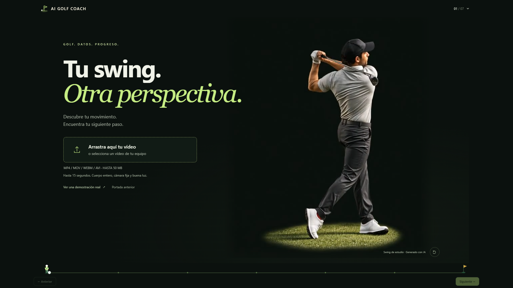
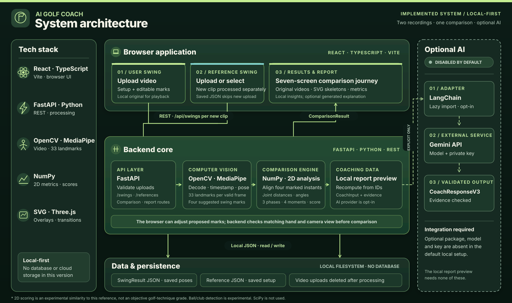
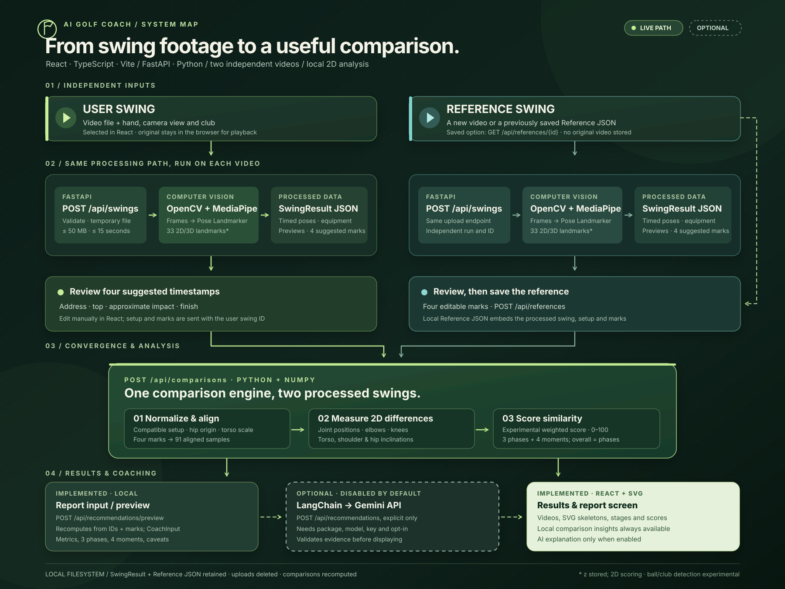
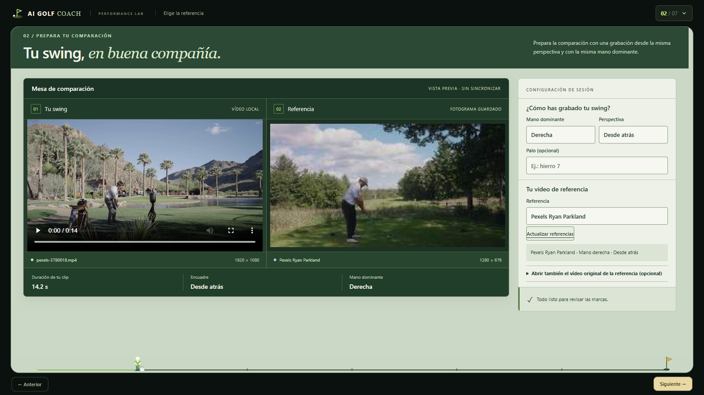
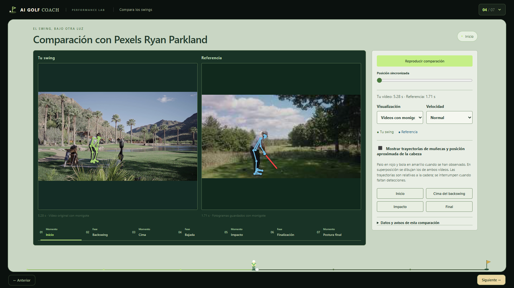
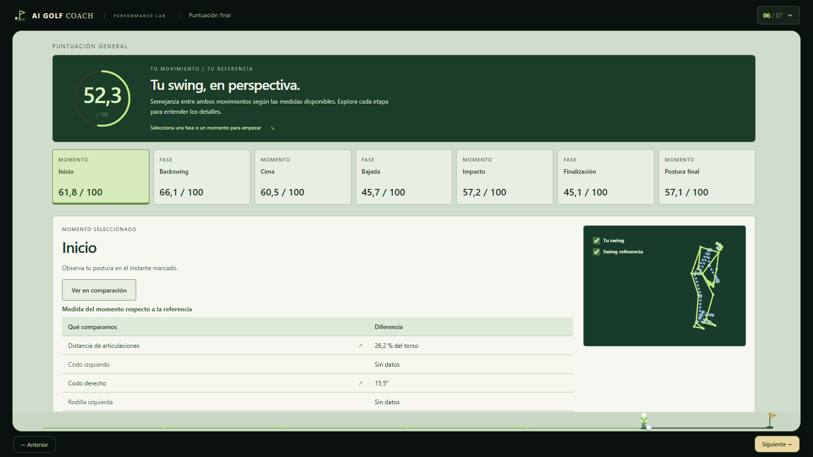
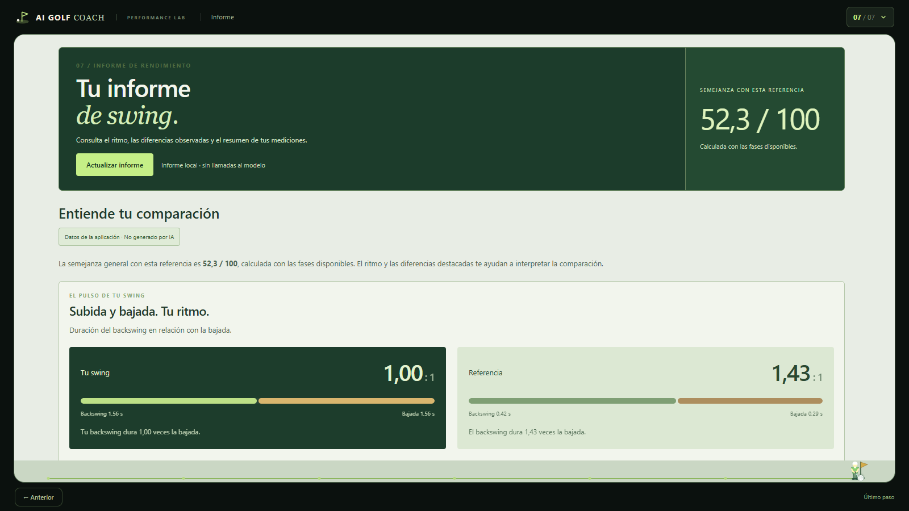

# AI Golf Coach

**See your swing from another perspective.** AI Golf Coach is a local web application that uses computer vision and pose estimation to compare two golf swings, align swing moments, display 2D biomechanical differences, and prepare evidence for AI-assisted coaching. It combines a seven-screen workflow with synchronized skeleton overlays and cinematic transitions. Scores express similarity to a chosen reference; they are experimental, not a universal rating of technique.

## Product Demo

[](demo/product-demo.mp4)

The **88-second [Product Demo V2](demo/product-demo.mp4)** walks through upload, MediaPipe pose detection, editable swing marks, comparison, metrics, and an **illustrative** AI coaching report with practice drills. It has Spanish narration and burned-in subtitles; the separate [Spanish SRT](demo/product-demo.srt) is included.

## System Architecture



The React/Vite frontend sends uploads and comparison requests to FastAPI. OpenCV and MediaPipe process each recording; Python/NumPy compare the resulting poses. Results and reference data remain on the local machine. The AI branch is **optional and off by default**. [Standalone HTML source (open locally)](docs/architecture/AI_GOLF_COACH_ARCHITECTURE_OVERVIEW.html) · [View the PNG](docs/architecture/AI_GOLF_COACH_ARCHITECTURE_OVERVIEW.png).

## Analysis Workflow



**User swing + reference swing → OpenCV frame extraction → MediaPipe landmarks → four editable swing marks → phase alignment → 2D biomechanical differences → experimental scores → local report preview → optional AI coaching report.** A saved reference reuses processed JSON; the original reference video may need to be reopened locally for playback. [Standalone HTML source (open locally)](docs/architecture/AI_GOLF_COACH_ARCHITECTURE.html) · [View the PNG](docs/architecture/AI_GOLF_COACH_ARCHITECTURE.png).

## Technology Stack

| Function | Implemented technology |
| --- | --- |
| Frontend | React 19, TypeScript, Vite, CSS |
| Backend and API | Python, FastAPI, Pydantic, Uvicorn |
| Computer vision | OpenCV, MediaPipe Pose Landmarker |
| Numerical processing | NumPy and local Python comparison logic |
| AI integration | Optional LangChain Google GenAI adapter for Gemini; disabled by default |
| Visualization | SVG/canvas pose drawings, Three.js cinematic transitions |
| Local persistence | JSON files for processed swings and saved references |

## Key Features

- Upload and process two independent swing videos (up to 15 seconds and 50 MB each).
- Extract time-indexed body landmarks with OpenCV and MediaPipe Pose Landmarker.
- Suggest four swing timestamps and let the user adjust them.
- Compare a user swing against a saved or newly processed reference with matching hand and camera view.
- Play synchronized videos and SVG pose overlays; inspect equivalent phases and moments.
- Measure 2D joint positions and angles, timing and experimental similarity scores.
- Review local comparison insights and prepare structured evidence for a coaching report.
- Optionally generate a seven-stage AI report with LangChain/Gemini when explicitly configured and requested. A report shown in the demo is illustrative, not a live model response.

## Screenshots

These are browser captures of the standalone app. The comparison uses **two distinct Pexels clips**, processed locally for this release check: Taryn Elliott's swing as the user input and Ryan Parkland's as the reference. The screenshots show real computed data; they do not imply either golfer endorses the product. The app's illustrated AI coaching output is intentionally absent because no provider was connected.

| Upload | Reference selection |
| --- | --- |
|  |  |
| **Pose comparison** | **Experimental scoring** |
|  |  |



## Quick Start

Tested locally with **64-bit Python 3.14.3** and **Node.js 22.23.4** on Windows. Use two PowerShell terminals in VS Code. Start from the repository root.

**Terminal 1 — backend**

```powershell
cd backend
python -m venv .venv
.\.venv\Scripts\python.exe -m pip install -r requirements.txt
.\.venv\Scripts\python.exe scripts/download_model.py
.\.venv\Scripts\python.exe -m uvicorn main:app --reload --reload-dir app --host 127.0.0.1 --port 8000
```

**Terminal 2 — frontend**

```powershell
cd frontend
npm.cmd ci
npm.cmd run dev
```

Open <http://127.0.0.1:5173/>. Check <http://127.0.0.1:8000/api/health> and <http://127.0.0.1:5173/api/health>; both should return `"status":"ok"`. The frontend dev server proxies `/api` to the backend. Stop either server with Ctrl+C. See the [full setup guide](docs/SETUP.md) for model download, environment variables and troubleshooting.

To try the complete flow, use **two different videos you are authorized to process**. Match dominant hand and camera perspective, film the full body with a fixed camera, review the four suggested timestamps, and proceed through the comparison. [Sample-video guidance](assets/samples/README.md) includes a documented external source; no personal videos are bundled.

## Testing

```powershell
cd frontend
npm.cmd test
npm.cmd run build
```

```powershell
cd backend
.\.venv\Scripts\python.exe -m pip install -r requirements-dev.txt
.\.venv\Scripts\python.exe -m unittest discover -s tests -v
```

The tests cover upload handling, pose/analysis logic, comparison and scoring, local report preparation, API behavior, frontend playback and visual-motion utilities. The build checks TypeScript and produces the production frontend. [Distribution validation](docs/VALIDATION.md) states what was actually run and what remains unverified.

## Configuration & Limitations

The root [`.env.example`](.env.example) lists optional variables. It is **not automatically loaded** by the app; set them in the appropriate terminal environment. The default dev ports are **8000** (FastAPI) and **5173** (Vite); `AIGOLF_BACKEND_URL` can change the Vite proxy target. Both servers bind to `127.0.0.1`; there is no CORS configuration needed for the proxied local development flow.

No external AI service is needed for upload, pose detection, comparison, scoring or the local report preview. For optional model-generated prose, install `backend/requirements-ai.txt` and explicitly configure the four `GOLF_COACH_AI_*` variables in [setup](docs/SETUP.md). The provider may incur third-party usage charges; no key is supplied.

This is a single-user local prototype. 2D pose estimates, club/ball detection and scores have real-world limitations; the app does not certify golf technique or ball contact. Saved result/reference JSON can contain frame previews and should be kept private. No authentication or public deployment setup is included.

## Project Structure

```text
frontend/             React app, 3D transitions, tests, runtime media
backend/              FastAPI app, analysis services, tests, model downloader
docs/architecture/    System map and analysis workflow (SVG, PNG, HTML)
docs/screenshots/     Application screenshots
demo/                 Product Demo V2 MP4, thumbnail and Spanish SRT
assets/samples/       Guidance for obtaining compatible test videos
docs/SETUP.md         Windows setup and optional AI configuration
docs/VALIDATION.md    Executed checks and known product limits
```

## License

**No software license has been granted yet.** Until the project owner chooses and adds one, the code remains under default copyright; publishing it on GitHub does not grant permission to reuse it. See [asset provenance](docs/ASSET_LICENSES.md) for the separate terms covering Pexels and Poly Haven resources.
